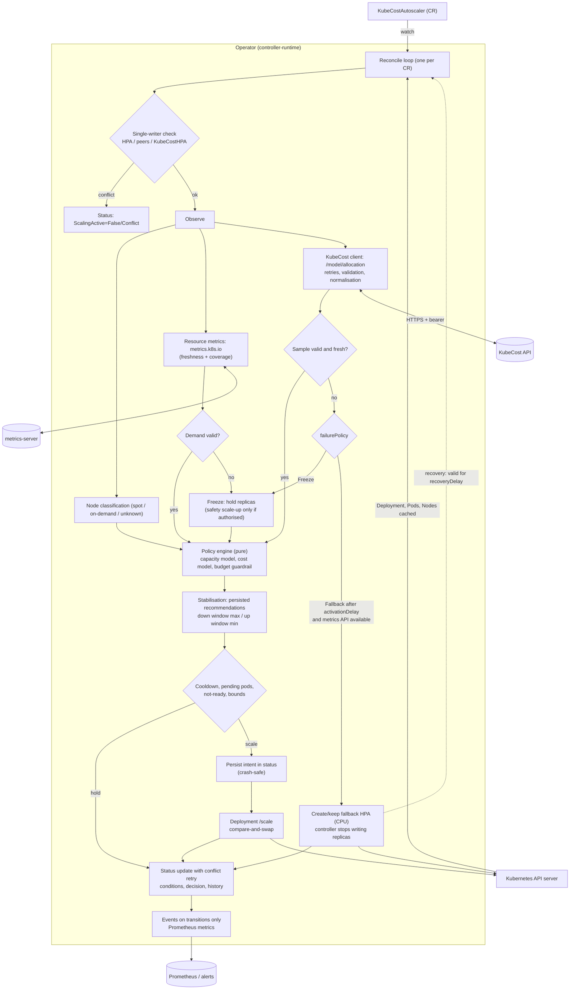

# KubeCost Auto-HPA

Operador nativo de Kubernetes que reemplaza el escalado por CPU/RAM con **Unit Economics Scaling**: ajusta
el tamaño de los Pods y migra cargas tolerantes a fallos a instancias Spot (AWS/GCP) evaluando la latencia
p99 y el costo financiero por petición servida.

```
 Prometheus / KubeCost / Spot API
              |
   Operator (Go, Kubebuilder)  -- evalúa SLO latencia vs costo
              |
   Unit Economics Engine (Python) -- costo / RPS
              |
   Control Plane & Guardrails  --> Spot Migration (cordon/drain)
              |
   Kube-API Resource Adjuster  -- in-place resize de requests/limits
```

## Propuesta de valor

`C_pod = Costo Instancia / RPS`. Escala según rentabilidad y SLO, no según picos de CPU/RAM.

## Funcionalidades

1. **Escalado por rentabilidad y SLOs** – reduce límites cuando la latencia p99 está holgada frente al SLA.
2. **Orquestador Spot** – detecta cargas tolerantes a fallos y gestiona cordon/drain.
3. **Hot-resizing in-place** – actualiza `requests`/`limits` sin rolling update.
4. **Guardrails de presupuesto** – congela el auto-escalado al alcanzar el límite mensual (`FinOps Agent`).

## Componentes

| Ruta | Qué es |
|---|---|
| `engine/` | Motor Unit Economics (Python, stdlib). Núcleo + API HTTP `POST /v1/evaluate`, `/healthz`, `/metrics`. |
| `operator/` | Operador Go (controller-runtime): CRD `KubeCostHPA`, reconciler, actuadores, cliente Prometheus/KubeCost, caché Redis. |
| `operator/internal/{policy,kubecost,money,infra,ownership,resmetrics}` | Motor de decisión puro (Go), cliente KubeCost, dinero exacto, clasificación Spot, propiedad de réplicas y métricas de recursos del `KubeCostAutoscaler`. |
| `operator/config/` | Kustomize: `default` (CRD, RBAC, operador, motor, Redis) y `overlays/local` (+ workload demo). |
| `deploy/helm/kubecost-auto-hpa/` | Chart de Helm equivalente. |
| `docker-compose.yml` | Stack local: Redis, motor, Prometheus, Grafana (+ operador con `--profile operator`). |

## Flujo de reconciliación

1. Lee `KubeCostHPA` y el Deployment objetivo (CPU/memoria solicitadas, pods en ejecución).
2. Métricas: RPS, p99 y uso de CPU desde Prometheus (consultas PromQL configurables en `internal/metrics`),
   con caché en Redis (30 s) y respaldo a la última lectura (15 min) si Prometheus cae.
3. Gasto mensual del namespace desde la API de asignación de KubeCost (si hay `budget`).
4. Llama al motor: decide `shrink`/`grow`/`hold`, calcula `$/request`, congelación por presupuesto y elegibilidad Spot.
5. Actúa: resize **in-place** vía subrecurso `pods/resize` (sin reinicio) y converge también los pods nuevos.
   El estado temporal (cooldown, última decisión) vive en Redis; `status` del CR es la fuente de verdad.
6. Publica estado/condiciones/eventos y métricas Prometheus (`kubecost_hpa_*`).

Un segundo controlador (`--enable-spot-drain`) hace **cordon + drain** de nodos Spot con señal de interrupción
(taint `aws-node-termination-handler/spot-itn`, `cloud.google.com/impending-node-termination` o la anotación
`autoscaling.kubecost.io/spot-interruption=true`), usando la Eviction API (respeta PDBs).

### Reglas de seguridad

- Nunca reduce la CPU por debajo de `uso_real / 0.7` ni fuera de `cpu.min`/`cpu.max`.
- Rechaza el resize si `resizePolicy` es `RestartContainer`; espera si hay un resize en curso.
- Sin métricas o con el motor caído no se hace nada (usa la última lectura si tiene < 15 min).
- Presupuesto: congelado solo bloquea **crecer** (CPU y réplicas); reducir siempre se permite. Si KubeCost no responde,
  `budget.onSpendUnavailable` decide: `Ignore` (por defecto, no se sacrifica el SLO) o `FreezeGrowth`.
- El drain se niega si no queda otro nodo listo o hay pods sin controlador, y reintenta evicciones bloqueadas por PDB hasta `--drain-timeout`.

### Ciclo de vida

Borrar un `KubeCostHPA` **devuelve los pods a los recursos del template** (finalizer, con un límite de 2 min para no bloquear nunca el borrado).
Las queries PromQL se pueden sobrescribir por recurso con `spec.metrics`. Guía completa de operación, alertas y fallos: [`docs/OPERATIONS.md`](docs/OPERATIONS.md).

### Anti-flapping asimétrico

- Reducir espera el `cooldown` completo tras cualquier cambio.
- Crecer (una brecha de SLO es una emergencia) **no espera** tras una reducción; solo se espacian dos crecimientos seguidos por `min(cooldown, 30 s)`.

### Validación del CRD

El apiserver rechaza (CEL + patrones): `cpu.min > cpu.max`, `memory.min > memory.max`, `replicas.max < replicas.min`, `replicas.min < 1`,
importes no numéricos o negativos y `onSpendUnavailable` desconocido. El motor rechaza `NaN`/`Infinity`, negativos y tipos erróneos con HTTP 400.

### Memoria y réplicas (opt-in)

- `spec.memory` activa el resize de memoria: **crece rápido** (+25 % si el uso supera el 85 %) y **reduce despacio**
  (máx. −10 % por decisión, nunca por debajo de `uso × 1.3`). La memoria sigue creciendo aunque el presupuesto esté congelado: un OOM es peor que el gasto.
- `spec.replicas` activa el escalado horizontal, solo cuando se agotó el margen vertical: +1 réplica si la CPU está en
  `cpu.max` y la p99 ≥ 90 % del SLO; −1 si la CPU está en `cpu.min`, hay holgura de latencia y las demás réplicas absorben la carga
  por debajo del 70 %. **No combinar con otro HPA sobre el mismo Deployment.**

### Seguridad

- Motor: `ENGINE_TOKEN` exige `Authorization: Bearer` en `/v1/*` (`/healthz` y `/metrics` quedan abiertos para probes).
  TLS con `TLS_CERT`/`TLS_KEY`; con `TLS_CLIENT_CA` exige certificado de cliente (mTLS).
- Operador → Prometheus / KubeCost / motor: flags `--<backend>-ca-file`, `--<backend>-client-cert/-key`,
  `--<backend>-bearer-token-file` (se relee en cada petición, soporta rotación) o env `PROMETHEUS_TOKEN`/`KUBECOST_TOKEN`/`ENGINE_TOKEN`.
- Helm: `auth.*` (tokens desde Secrets), `tls.engine.*`, `networkPolicy.enabled`, PDBs, `prometheusRule.enabled`.
- Redis: contraseña (`REDIS_PASSWORD`) y TLS/mTLS (`--redis-tls`, `--redis-ca-file`, `--redis-client-cert/-key`); además `networkPolicy.enabled`.

### Métricas del operador

`kubecost_hpa_cost_per_request_usd`, `kubecost_hpa_desired_cpu_millicores`, `kubecost_hpa_estimated_savings_usd_per_hour`,
`kubecost_hpa_savings_usd_total` (ahorro acumulado), `kubecost_hpa_budget_frozen`, `kubecost_hpa_resizes_total`, `kubecost_spot_drains_total`.
Dashboard de Grafana en `deploy/compose/grafana/dashboards/`.

Para `KubeCostAutoscaler` el chart incluye un dashboard de Grafana (réplicas actuales/deseadas, costo vs presupuesto,
edad de la muestra de KubeCost, fallback, errores de la API por clase, decisiones y escrituras): actívalo con
`--set grafanaDashboard.enabled=true` (ConfigMap con la etiqueta `grafana_dashboard` que lee el sidecar de Grafana).
Se validó que el JSON y la plantilla se renderizan; no se ha cargado en un Grafana real. Los valores del chart se validan
con `values.schema.json` (una clave mal escrita falla en `helm install` en vez de ignorarse).

## KubeCostAutoscaler: escalado horizontal consciente del costo

Recurso namespaced `autoscaling.kubecost.io/v1alpha1 KubeCostAutoscaler` que gestiona las **réplicas** de un Deployment.
La demanda (utilización vía `metrics.k8s.io`) decide; el costo de KubeCost es una señal de optimización **acotada**:
un costo menor nunca elimina capacidad por sí solo y un presupuesto excedido nunca deja sub-escalada una carga sobrecargada.
Documentación completa (auditoría, algoritmo, modelo de costos, políticas de fallo, seguridad): [`docs/KUBECOST_AUTOSCALER.md`](docs/KUBECOST_AUTOSCALER.md).

```yaml
apiVersion: autoscaling.kubecost.io/v1alpha1
kind: KubeCostAutoscaler
metadata: {name: payments-autoscaler, namespace: production}
spec:
  targetRef: {apiVersion: apps/v1, kind: Deployment, name: payments-api}   # mismo namespace, inmutable
  minReplicas: 3
  maxReplicas: 20
  dryRun: true
  costPolicy: {maxHourlyCostUSD: "5.00", targetHourlyCostUSD: "4.00", scaleUpCostGuardrail: true}
  stabilization: {downscaleWindow: 10m, scaleUpWindow: 30s, minimumScaleActionInterval: 60s}
  failurePolicy: {mode: Freeze, maxMetricAge: 5m}          # o ResourceMetricsFallback
  infrastructurePolicy: {spotMultiplier: "0.35", onDemandMultiplier: "1.0", spotInterruptionBufferPercent: 20}
```

**Modelo de propiedad (un solo escritor).** Un reconciliador dedicado es el único que escribe `spec.replicas`. Antes de cada
evaluación detecta HPAs nativos, otros `KubeCostAutoscaler` y `KubeCostHPA` con `spec.replicas` sobre el mismo Deployment y, si
los hay, **no escribe** (`ScalingActive=False/Conflict`). En modo `ResourceMetricsFallback` crea un HPA nativo propio (con
`ownerReference`) y deja de escribir réplicas mientras exista.

**Algoritmo en una línea.** `candidato = max(réplicas_de_seguridad, min(réplicas_cómodas, réplicas_con_presión_de_costo, presupuesto))`,
luego ventana de estabilización persistida (bajada: máximo de la ventana; subida: mínimo), cooldown y puertas de seguridad
(pods pendientes, réplicas no listas). Las ventanas, el cooldown y la frescura de métricas son tres controles independientes.

**Fallos.** KubeCost caído / 5xx / JSON malformado / dato viejo o parcial → *Freeze* (sin bajadas; subida de seguridad solo si
`allowSafetyScaleUp`). Con `ResourceMetricsFallback` y la API de métricas disponible, tras `fallbackActivationDelay` se delega en
un HPA de CPU y se recupera tras `recoveryDelay`. Cada escenario tiene un test (tabla en la documentación §9).



## Uso

```yaml
apiVersion: autoscaling.kubecost.io/v1alpha1
kind: KubeCostHPA
metadata: {name: checkout, namespace: shop}
spec:
  targetRef: {name: checkout}
  slo: {p99LatencyMs: 250}
  cpu: {min: 100m, max: "2"}
  unitEconomics: {maxCostPerRequest: "0.000002"}
  budget: {monthlyLimitUSD: "5000"}
  spot: {enabled: true, faultTolerant: true}
  memory: {min: 64Mi, max: 2Gi}      # opt-in
  replicas: {min: 2, max: 10}        # opt-in
  dryRun: true      # empezar en dry-run
```

Requisitos del clúster: Kubernetes ≥ 1.33 (`InPlacePodVerticalScaling` beta, subrecurso `pods/resize`),
Prometheus con métricas `http_requests_total` / `http_request_duration_seconds`, y KubeCost (opcional).

El resize in-place cambia el Pod, no el template del Deployment: el operador lo reaplica a pods nuevos,
pero un cambio manual del template vuelve a ser la base.

## Despliegue

```
# Local (stack de observabilidad + motor + Redis)
docker compose up -d --build
# Operador contra un clúster kind/minikube
docker compose --profile operator up -d --build

# Kustomize
kubectl apply -k operator/config/default
kubectl apply -k operator/config/overlays/local      # imágenes locales + workload demo

# Helm
helm install kch deploy/helm/kubecost-auto-hpa -n kubecost-auto-hpa-system --create-namespace \
  --set prometheus.url=http://prometheus-server.monitoring:80
```

## Desarrollo y pruebas

```
cd engine && pip install -e '.[dev]' && pytest
cd operator && make test           # unitarias (clientes fake, miniredis, httptest)
cd operator && make integration    # E2E con el motor Python real + Redis + Prometheus/KubeCost simulados
cd operator && make envtest        # contra un kube-apiserver 1.33 + etcd REALES (KUBEBUILDER_ASSETS)
make -C operator e2e-kind          # clúster kind 1.33 real, imágenes reales (necesita docker + kind)
hack/e2e-kca.sh                    # kind + metrics-server: KubeCostAutoscaler (necesita docker + kind + kubectl)
cd operator && make manifests      # regenera deepcopy, CRD, RBAC y copia el CRD al chart (requiere controller-gen)
```

## Estado de verificación

| Nivel | Qué cubre | Estado |
|---|---|---|
| Unitarias Python / Go | motor, clientes, resizer, drainer, reconciler | ✅ ejecutadas |
| E2E con motor real | reconciler + motor Python + Redis (miniredis) + Prometheus/KubeCost simulados | ✅ ejecutado |
| **envtest (kube-apiserver 1.33.4 + etcd reales)** | defaults del CRD, `pods/resize`, subrecurso `scale`, Eviction + PDB, y el **binario real del manager** | ✅ ejecutado |
| **`KubeCostAutoscaler` en envtest** | defaults/validación CEL del CRD (17 formas inválidas rechazadas), `/scale` con compare-and-swap, HPA nativo real (conflicto y fallback), el binario real del manager con un KubeCost simulado | ✅ ejecutado |
| `-race` | `go test -race -p 2 ./...` | ✅ ejecutado |
| kind 1.33 (`hack/e2e-kind.sh`) | kubelet real: resize sin reinicio, pods sin recrear, imágenes Docker de operador y motor | ✅ pasa en CI de GitHub (job `e2e-kind`) |
| kind 1.33 + metrics-server real (`hack/e2e-kca.sh`) | `KubeCostAutoscaler`: una carga que consume CPU se escala por `/scale` y el estado publica la decisión; KubeCost simulado (su respuesta se validó con el cliente real) | ✅ pasa en CI de GitHub (job `e2e-kca`). **Sin KubeCost real**: el formato se verificó contra el código de OpenCost, no contra una instalación |
| `release.yml` | build multi-arch y publicación en GHCR (chart OCI en tags `v*`) | ✅ imágenes publicadas tras el merge a `main`; la publicación del chart (tag) aún no se ha ejecutado |
| Helm / Kustomize / Compose | `lint`, `template`, `build`, `config` | ✅ ejecutados (sin instalar en un clúster) |

Límites conocidos: sin kubelet en envtest no se observa el cambio efectivo de cgroups tras un resize; la caché del
reconciler puede ver un pod con retraso (el patch es idempotente);  las consultas PromQL por defecto
asumen `http_requests_total` / `http_request_duration_seconds` (configurables en `internal/metrics`).

## Licencia

[Apache License 2.0](LICENSE): licencia permisiva con concesión expresa de patentes, la misma que usan Kubernetes,
controller-runtime y OpenCost, de modo que el código es compatible con las dependencias del proyecto.
