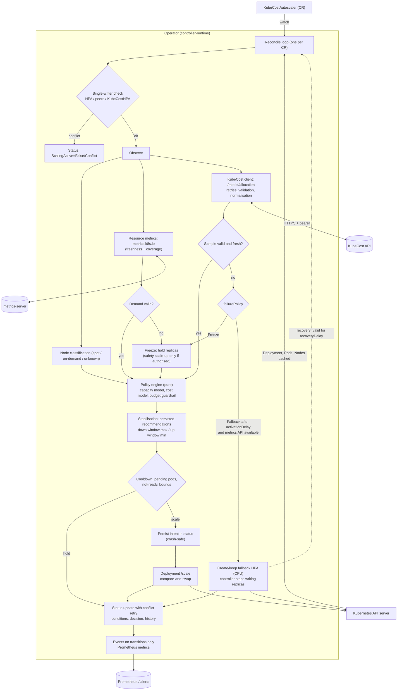

# KubeCost Auto-HPA (ScaleOps Parity Edition)

[](https://github.com/Santidelacarrera/KubeCost_Auto_HPA/actions/workflows/ci.yml)
[](https://github.com/Santidelacarrera/KubeCost_Auto_HPA/actions/workflows/release.yml)
[](https://github.com/Santidelacarrera/KubeCost_Auto_HPA/releases/tag/v0.1.0)
[](LICENSE)
[](https://kubernetes.io)
[](https://santidelacarrera.github.io/KubeCost_Auto_HPA/app.html)

Operador autónomo de Kubernetes de alta disponibilidad con **Unit Economics Scaling** y **paridad funcional total con ScaleOps**: ajusta réplicas de forma predictiva, redimensiona contenedores en caliente (*in-place resize*) sin reinicios, previene caídas por OOM y consolida el clúster (*node bin-packing*) para maximizar el ahorro en AWS/GCP sin violar los SLOs de latencia p99.

> **Estado (2026-11-11): listo para producción en modo observe-only**, que es el modo por defecto del chart: el operador mide, recomienda e informa, y no escribe nada en el clúster. Verificado en clústeres gestionados reales (GKE 1.36.4 y AKS 1.36.5) además del laboratorio: [`docs/LAB.md`](docs/LAB.md).
> **La aplicación de cambios** (applier con aprobación humana, rollback automático por SLO) pasó todas sus pruebas en GKE y AKS reales (AKS: 27/27) y está **lista para un piloto supervisado**, no para operar sin supervisión: falta tráfico real de semanas, la conciliación con una factura y EKS ([`docs/ROADMAP.md`](docs/ROADMAP.md), P0).

🌐 **Consola Enterprise en Vivo:** [https://santidelacarrera.github.io/KubeCost_Auto_HPA/app.html](https://santidelacarrera.github.io/KubeCost_Auto_HPA/app.html)  
🏢 **Landing Comercial y ROI:** [https://santidelacarrera.github.io/KubeCost_Auto_HPA/](https://santidelacarrera.github.io/KubeCost_Auto_HPA/)

```
 Prometheus / KubeCost / Spot API
              |
   Operator (Go, Kubebuilder)  -- evalúa SLO latencia vs costo
              |
   Unit Economics Engine (Python) -- costo / RPS
              |
   Control Plane & Guardrails  --> Spot Migration (cordon/drain)
              |
   Kube-API Resource Adjuster  -- in-place resize de requests/limits
```

## Propuesta de valor

`C_pod = Costo Instancia / RPS`. Escala según rentabilidad y SLO, no según picos de CPU/RAM.

## Funcionalidades Clave (Paridad Total con ScaleOps)

1. **Predictive Horizontal Scaling (Pre-Warming)** – Pronostica subidas de demanda y precalienta réplicas antes de los picos estacionales para mantener la latencia p99 por debajo del SLO.
2. **OOM Protection Shield** – Monitorea la velocidad de memoria cgroup (`dMem/dt`); infla dinámicamente los límites de memoria en caliente mediante `pods/resize` de K8s 1.33+ sin reiniciar los pods (adiós exit code 137).
3. **Cluster Optimization & Node Bin-Packing** – Detecta nodos subutilizados (< 35%) y gestiona cordoning/draining respetando PDBs para que Karpenter o Cluster Autoscaler eliminen instancias ociosas.
4. **Escalado por rentabilidad y SLOs** – Reduce límites cuando la latencia p99 está holgada frente al SLA, calculando el coste unitario por petición.
5. **Orquestador Spot** – Detecta cargas tolerantes a fallos y gestiona cordon/drain con anticipación ante avisos de interrupción.
6. **Hot-resizing in-place** – Actualiza `requests`/`limits` sin rolling updates ni reinicios de contenedores.
7. **Guardrails de presupuesto** – Congela el auto-escalado al alcanzar el límite mensual (`FinOps Agent`).
8. **Consola Web Enterprise Desacoplada** – Dashboard SPA profesional con simulador de 500 usuarios concurrentes en vivo y calculadora de ROI.
9. **Bus de Telemetría Nexus Lab** – Publicación de eventos `finops.scaling_decision` hacia Redis Streams (`nexus:telemetry`) con identificadores UUIDv7 para auditoría e integración con `Nexus_Client_Portal`.

## Componentes

| Ruta | Qué es |
|---|---|
| `engine/` | Motor Unit Economics & ScaleOps (Python 3.12). Algoritmos de predicción, escudo OOM, bin-packing, productor de telemetría Nexus y API HTTP `POST /v1/evaluate`. |
| `operator/` | Operador Go (controller-runtime): CRDs `KubeCostAutoscaler` y `KubeCostHPA`, reconciliadores, actuadores in-place, clientes Prometheus/KubeCost. |
| `operator/internal/{policy,kubecost,money,infra,ownership,resmetrics}` | Motor de decisión puro (Go), cliente KubeCost, dinero exacto, clasificación Spot, propiedad de réplicas y métricas de recursos del `KubeCostAutoscaler`. |
| `operator/config/` | Kustomize: `default` (CRD, RBAC, operador, motor, Redis) y `overlays/local` (+ workload demo). |
| `deploy/helm/kubecost-auto-hpa/` | Chart de Helm equivalente. |
| `operator/cmd/recommend`, `operator/internal/recommend/` | Read-only rightsizing recommender (CLI, Prometheus history). Phase 1, unverified on a real cluster: [`docs/RECOMMENDER.md`](docs/RECOMMENDER.md). |
| `operator/internal/{safety,execute,cost,capacity}`, `operator/cmd/rightsize` | Política fail-closed, aplicación con rollback y auditoría, asignación de costos, análisis de capacidad (ver más abajo). |
| `frontend/` | Consola web comercial independiente (`index.html`, `app.html`, `pricing.html`) desplegada en GitHub Pages. |
| `deploy/helm/kubecost-auto-hpa/` | Chart de Helm enterprise versionado, con validación OpenAPI v3 y flags `features.*` y `telemetry.*`. |
| `docker-compose.yml` | Stack local: Redis, motor, Prometheus, Grafana (+ operador con `--profile operator`). |

## Flujo de reconciliación

1. Lee `KubeCostHPA` y el Deployment objetivo (CPU/memoria solicitadas, pods en ejecución).
2. Métricas: RPS, p99 y uso de CPU desde Prometheus (consultas PromQL configurables en `internal/metrics`),
   con caché en Redis (30 s) y respaldo a la última lectura (15 min) si Prometheus cae.
3. Gasto mensual del namespace desde la API de asignación de KubeCost (si hay `budget`).
4. Llama al motor: decide `shrink`/`grow`/`hold`, calcula `$/request`, congelación por presupuesto y elegibilidad Spot.
5. Actúa: resize **in-place** vía subrecurso `pods/resize` (sin reinicio) y converge también los pods nuevos.
   El estado temporal (cooldown, última decisión) vive en Redis; `status` del CR es la fuente de verdad.
6. Publica estado/condiciones/eventos y métricas Prometheus (`kubecost_hpa_*`).

Un segundo controlador (`--enable-spot-drain`) hace **cordon + drain** de nodos Spot con señal de interrupción
(taint `aws-node-termination-handler/spot-itn`, `cloud.google.com/impending-node-termination` o la anotación
`autoscaling.kubecost.io/spot-interruption=true`), usando la Eviction API (respeta PDBs).

### Reglas de seguridad

- Nunca reduce la CPU por debajo de `uso_real / 0.7` ni fuera de `cpu.min`/`cpu.max`.
- Rechaza el resize si `resizePolicy` es `RestartContainer`; espera si hay un resize en curso.
- Sin métricas o con el motor caído no se hace nada (usa la última lectura si tiene < 15 min).
- Presupuesto: congelado solo bloquea **crecer** (CPU y réplicas); reducir siempre se permite. Si KubeCost no responde,
  `budget.onSpendUnavailable` decide: `Ignore` (por defecto, no se sacrifica el SLO) o `FreezeGrowth`.
- El drain se niega si no queda otro nodo listo o hay pods sin controlador, y reintenta evicciones bloqueadas por PDB hasta `--drain-timeout`.

### Ciclo de vida

Borrar un `KubeCostHPA` **devuelve los pods a los recursos del template** (finalizer, con un límite de 2 min para no bloquear nunca el borrado).
Las queries PromQL se pueden sobrescribir por recurso con `spec.metrics`. Guía completa de operación, alertas y fallos: [`docs/OPERATIONS.md`](docs/OPERATIONS.md).

### Anti-flapping asimétrico

- Reducir espera el `cooldown` completo tras cualquier cambio.
- Crecer (una brecha de SLO es una emergencia) **no espera** tras una reducción; solo se espacian dos crecimientos seguidos por `min(cooldown, 30 s)`.

### Validación del CRD

El apiserver rechaza (CEL + patrones): `cpu.min > cpu.max`, `memory.min > memory.max`, `replicas.max < replicas.min`, `replicas.min < 1`,
importes no numéricos o negativos y `onSpendUnavailable` desconocido. El motor rechaza `NaN`/`Infinity`, negativos y tipos erróneos con HTTP 400.

### Memoria y réplicas (opt-in)

- `spec.memory` activa el resize de memoria: **crece rápido** (+25 % si el uso supera el 85 %) y **reduce despacio**
  (máx. −10 % por decisión, nunca por debajo de `uso × 1.3`). La memoria sigue creciendo aunque el presupuesto esté congelado: un OOM es peor que el gasto.
- `spec.replicas` activa el escalado horizontal, solo cuando se agotó el margen vertical: +1 réplica si la CPU está en
  `cpu.max` y la p99 ≥ 90 % del SLO; −1 si la CPU está en `cpu.min`, hay holgura de latencia y las demás réplicas absorben la carga
  por debajo del 70 %. **No combinar con otro HPA sobre el mismo Deployment.**

### Seguridad, Aislamiento Multi-Tenant (BOLA/IDOR) y Rate Limiting Distribuido

- **Autenticación Unificada (`/v1/*`):** Todas las rutas privadas bajo `/v1/*` (`GET` y `POST`) exigen autenticación mediante `ENGINE_TOKEN` (operador Go M2M), `ENGINE_ADMIN_TOKEN` o API Keys multi-tenant `kc_live_*` / `kch_live_*` gestionadas por `MultiTenantAuthManager` (hash SHA-256 en tiempo constante, expiración por defecto de **90 días** `expires_in_days=90`, revocación y rotación atómica). Con `KUBECOST_ENV=production`, la ausencia de `ENGINE_TOKEN` **nunca** habilita silenciosamente el modo demo.
- **Excepciones Públicas Explícitas:** Solo `/healthz`, `/health`, `/readyz` y los activos estáticos de `web/` son públicos. `POST /v1/billing/stripe-webhook` exige firma criptográfica `Stripe-Signature` HMAC-SHA256 con ventana anti-replay de 300 s e idempotencia por `event_id` (sin secretos fallback por defecto; si `STRIPE_WEBHOOK_SECRET` no está configurado, falla cerrado con `HTTP 503`).
- **Prevención BOLA / IDOR (`_verify_tenant_access`):** `X-Tenant-ID` nunca se acepta como prueba de identidad por sí solo. El tenant efectivo proviene de la credencial autenticada (`kc_live_*` / `kch_live_*` o `ENGINE_TOKEN_TENANT_ID`) y se valida frente a `client_id`, `tenant_id` y la propiedad de recursos (`cluster_id`, `command_id`, `event_id`, `decision_id`), devolviendo `HTTP 403 Forbidden` ante cualquier intento de acceso cruzado.
- **Rate Limiting Distribuido (`REDIS_URL`) y Cuotas Diarias:** `DistributedRateLimiter` ejecuta contadores atómicos con scripts Lua en Redis (`REDIS_URL`) y falla cerrado (`HTTP 503`) en producción multi-réplica si Redis no está disponible:
  - `POST /v1/auth/keys`: `10 req/min/IP` (`RATE_LIMIT_AUTH_KEYS_PER_MIN`).
  - Cómputo intensivo (`/v1/evaluate`, `/v1/cluster/binpack`, `/v1/gpu/optimize`, `/v1/gameday/simulate`): `60 req/min/tenant` (`RATE_LIMIT_COMPUTE_PER_MIN`) + cuota diaria atómica de `10,000 evaluaciones/día/tenant` (`RATE_LIMIT_DAILY_EVAL_QUOTA=10000`).
  - Telemetría del operador Go (`/v1/telemetry/ingest`, `/v1/agents/heartbeat`): `600 req/min/tenant` (`RATE_LIMIT_TELEMETRY_PER_MIN`) con cuota independiente para no interferir con el bucle de reconciliación.
  - Lectura general (`/v1/*`): `120 req/min/tenant` (`RATE_LIMIT_GENERAL_PER_MIN`).
  - Al superar el límite devuelve `HTTP 429 Too Many Requests` con cabeceras `Retry-After`, `X-RateLimit-Limit` y `X-RateLimit-Remaining`.
- **Validación Estricta y Cabeceras HTTP:** Rechazo de `NaN`/`Infinity` (`math.isfinite`), validación de identificadores, límite estricto de `1 MiB` (`HTTP 413`) en todos los cuerpos JSON (incluyendo `POST /v1/cluster/binpack`) y cabeceras `X-Content-Type-Options: nosniff`, `Referrer-Policy: strict-origin-when-cross-origin`, `Cache-Control: no-store` y `X-Frame-Options` / `CSP frame-ancestors` (configurable con `ALLOWED_FRAME_ANCESTORS` para integración con `Nexus_Client_Portal`).
- **Plantilla de Variables de Entorno:** Consulta [`.env.example`](.env.example) para la referencia completa de variables sin secretos reales.
- **TLS / mTLS y Helm:** `TLS_CERT`/`TLS_KEY` y `TLS_CLIENT_CA` en el motor; flags `--<backend>-ca-file`, `--<backend>-client-cert/-key`, `--<backend>-bearer-token-file` en el operador Go; y `values-production.yaml` en Helm.

### Métricas del operador

`kubecost_hpa_cost_per_request_usd`, `kubecost_hpa_desired_cpu_millicores`, `kubecost_hpa_estimated_savings_usd_per_hour`,
`kubecost_hpa_savings_usd_total` (ahorro acumulado), `kubecost_hpa_budget_frozen`, `kubecost_hpa_resizes_total`, `kubecost_spot_drains_total`.
Dashboard de Grafana en `deploy/compose/grafana/dashboards/`.

Para `KubeCostAutoscaler` el chart incluye un dashboard de Grafana (réplicas actuales/deseadas, costo vs presupuesto,
edad de la muestra de KubeCost, fallback, errores de la API por clase, decisiones y escrituras): actívalo con
`--set grafanaDashboard.enabled=true` (ConfigMap con la etiqueta `grafana_dashboard` que lee el sidecar de Grafana).
Se validó que el JSON y la plantilla se renderizan; no se ha cargado en un Grafana real. Los valores del chart se validan
con `values.schema.json` (una clave mal escrita falla en `helm install` en vez de ignorarse).

## KubeCostAutoscaler: escalado horizontal consciente del costo

Recurso namespaced `autoscaling.kubecost.io/v1alpha1 KubeCostAutoscaler` que gestiona las **réplicas** de un Deployment.
La demanda (utilización vía `metrics.k8s.io`) decide; el costo de KubeCost es una señal de optimización **acotada**:
un costo menor nunca elimina capacidad por sí solo y un presupuesto excedido nunca deja sub-escalada una carga sobrecargada.
Documentación completa (auditoría, algoritmo, modelo de costos, políticas de fallo, seguridad): [`docs/KUBECOST_AUTOSCALER.md`](docs/KUBECOST_AUTOSCALER.md).

```yaml
apiVersion: autoscaling.kubecost.io/v1alpha1
kind: KubeCostAutoscaler
metadata: {name: payments-autoscaler, namespace: production}
spec:
  targetRef: {apiVersion: apps/v1, kind: Deployment, name: payments-api}   # mismo namespace, inmutable
  minReplicas: 3
  maxReplicas: 20
  dryRun: true
  costPolicy: {maxHourlyCostUSD: "5.00", targetHourlyCostUSD: "4.00", scaleUpCostGuardrail: true}
  stabilization: {downscaleWindow: 10m, scaleUpWindow: 30s, minimumScaleActionInterval: 60s}
  failurePolicy: {mode: Freeze, maxMetricAge: 5m}          # o ResourceMetricsFallback
  infrastructurePolicy: {spotMultiplier: "0.35", onDemandMultiplier: "1.0", spotInterruptionBufferPercent: 20}
```

**Modelo de propiedad (un solo escritor).** Un reconciliador dedicado es el único que escribe `spec.replicas`. Antes de cada
evaluación detecta HPAs nativos, otros `KubeCostAutoscaler` y `KubeCostHPA` con `spec.replicas` sobre el mismo Deployment y, si
los hay, **no escribe** (`ScalingActive=False/Conflict`). En modo `ResourceMetricsFallback` crea un HPA nativo propio (con
`ownerReference`) y deja de escribir réplicas mientras exista.

**Algoritmo en una línea.** `candidato = max(réplicas_de_seguridad, min(réplicas_cómodas, réplicas_con_presión_de_costo, presupuesto))`,
luego ventana de estabilización persistida (bajada: máximo de la ventana; subida: mínimo), cooldown y puertas de seguridad
(pods pendientes, réplicas no listas). Las ventanas, el cooldown y la frescura de métricas son tres controles independientes.

**Fallos.** KubeCost caído / 5xx / JSON malformado / dato viejo o parcial → *Freeze* (sin bajadas; subida de seguridad solo si
`allowSafetyScaleUp`). Con `ResourceMetricsFallback` y la API de métricas disponible, tras `fallbackActivationDelay` se delega en
un HPA de CPU y se recupera tras `recoveryDelay`. Cada escenario tiene un test (tabla en la documentación §9).



## Uso

```yaml
apiVersion: autoscaling.kubecost.io/v1alpha1
kind: KubeCostHPA
metadata: {name: checkout, namespace: shop}
spec:
  targetRef: {name: checkout}
  slo: {p99LatencyMs: 250}
  cpu: {min: 100m, max: "2"}
  unitEconomics: {maxCostPerRequest: "0.000002"}
  budget: {monthlyLimitUSD: "5000"}
  spot: {enabled: true, faultTolerant: true}
  memory: {min: 64Mi, max: 2Gi}      # opt-in
  replicas: {min: 2, max: 10}        # opt-in
  dryRun: true      # empezar en dry-run
```

Requisitos del clúster: Kubernetes ≥ 1.33 (`InPlacePodVerticalScaling` beta, subrecurso `pods/resize`),
Prometheus con métricas `http_requests_total` / `http_request_duration_seconds`, y KubeCost (opcional).

El resize in-place cambia el Pod, no el template del Deployment: el operador lo reaplica a pods nuevos,
pero un cambio manual del template vuelve a ser la base.

## Despliegue

```
# Local (stack de observabilidad + motor + Redis)
docker compose up -d --build
# Operador contra un clúster kind/minikube
docker compose --profile operator up -d --build

# Kustomize
kubectl apply -k operator/config/default
kubectl apply -k operator/config/overlays/local      # imágenes locales + workload demo

# Helm
helm install kch deploy/helm/kubecost-auto-hpa -n kubecost-auto-hpa-system --create-namespace \
  --set prometheus.url=http://prometheus-server.monitoring:80
```

## Desarrollo y pruebas

```
cd engine && pip install -e '.[dev]' && pytest
cd operator && make test           # unitarias (clientes fake, miniredis, httptest)
cd operator && make integration    # E2E con el motor Python real + Redis + Prometheus/KubeCost simulados
cd operator && make envtest        # contra un kube-apiserver 1.33 + etcd REALES (KUBEBUILDER_ASSETS)
make -C operator e2e-kind          # clúster kind 1.33 real, imágenes reales (necesita docker + kind)
hack/e2e-kca.sh                    # kind + metrics-server: KubeCostAutoscaler (necesita docker + kind + kubectl)
cd operator && make manifests      # regenera deepcopy, CRD, RBAC y copia el CRD al chart (requiere controller-gen)
```

## Estado de verificación

| Nivel | Qué cubre | Estado |
|---|---|---|
| Unitarias Python / Go | motor, clientes, resizer, drainer, reconciler | ✅ ejecutadas |
| E2E con motor real | reconciler + motor Python + Redis (miniredis) + Prometheus/KubeCost simulados | ✅ ejecutado |
| **envtest (kube-apiserver 1.33.4 + etcd reales)** | defaults del CRD, `pods/resize`, subrecurso `scale`, Eviction + PDB, y el **binario real del manager** | ✅ ejecutado |
| **`KubeCostAutoscaler` en envtest** | defaults/validación CEL del CRD (17 formas inválidas rechazadas), `/scale` con compare-and-swap, HPA nativo real (conflicto y fallback), el binario real del manager con un KubeCost simulado | ✅ ejecutado |
| `-race` | `go test -race -p 2 ./...` | ✅ ejecutado |
| kind 1.33 (`hack/e2e-kind.sh`) | kubelet real: resize sin reinicio, pods sin recrear, imágenes Docker de operador y motor | ✅ pasa en CI de GitHub (job `e2e-kind`) |
| kind 1.33 + metrics-server real (`hack/e2e-kca.sh`) | `KubeCostAutoscaler`: una carga que consume CPU se escala por `/scale` y el estado publica la decisión; KubeCost simulado (su respuesta se validó con el cliente real) | ✅ pasa en CI de GitHub (job `e2e-kca`). **Sin KubeCost real**: el formato se verificó contra el código de OpenCost, no contra una instalación |
| `release.yml` | build multi-arch y publicación en GHCR (chart OCI en tags `v*`) | ✅ imágenes publicadas tras el merge a `main`; la publicación del chart (tag) aún no se ha ejecutado |
| Helm / Kustomize / Compose | `lint`, `template`, `build`, `config` | ✅ ejecutados (sin instalar en un clúster) |

Límites conocidos: sin kubelet en envtest no se observa el cambio efectivo de cgroups tras un resize; la caché del
reconciler puede ver un pod con retraso (el patch es idempotente);  las consultas PromQL por defecto
asumen `http_requests_total` / `http_request_duration_seconds` (configurables en `internal/metrics`).

### Parada de emergencia y comparación sintética

`kubectl annotate kubecostautoscaler <nombre> autoscaling.kubecost.io/pause=true` detiene todas las escrituras de ese
autoscaler al instante (sigue calculando y explicando decisiones; no cambia réplicas ni crea/borra el HPA de respaldo);
quitar la anotación reanuda sin reiniciar. `docs/BENCHMARKS.md` compara, con un simulador determinista y supuestos
explícitos, el HPA nativo frente al motor de decisión (no son mediciones de un clúster real);
`docs/ENGINEERING_REPORT.md` resume hallazgos, pruebas ejecutadas y riesgos pendientes.

Documentación de esta fase de validación: `docs/RBAC.md` (permisos y su justificación), `docs/OBSERVABILITY.md` (métricas y SLO propuestos),
`docs/BENCHMARK_PROCEDURE.md` (medición real, no ejecutada), `docs/DEMAND_SIGNALS.md` (análisis), `docs/SUPPLY_CHAIN.md` (SBOM, escaneo y firma, con su estado real)
y `docs/RELEASING.md` (ensayos y procedimiento de release). Para evaluarlo en un piloto: `docs/PILOT.md` (instalación,
permisos, política de fallos, pausa, rollback y criterios de salida) y `docs/THREAT_MODEL.md` (amenazas, controles y riesgos
residuales). Antes de ejecutar la suite completa, `make -C operator test-all` (requiere `KUBEBUILDER_ASSETS`).

## Rightsizing seguro: recomendar, autorizar, aplicar, observar, revertir

Segunda mitad del repositorio (ADR-0001 y ADR-0002), independiente del autoscaler de réplicas. **Por defecto no cambia nada**: el chart instala el operador en
`observe-only` (`operator.observeOnly=true`) y la herramienta `rightsize` es dry-run salvo `--execute` con `--context` explícito.

```
cmd/recommend  -> recomendación JSON (percentiles + headroom; se abstiene sin datos fiables; no reduce con OOM, throttling, restarts o SLO roto)
cmd/rightsize plan      -> recomendación + hechos del clúster (HPA en CPU, VPA, etiqueta de exclusión)
cmd/rightsize approve   -> aprobación del ID exacto, sellada con la identidad que reporta el API server
cmd/rightsize apply     -> política (fail-closed) -> aplica (Deployment, StatefulSet, DaemonSet) con estado previo guardado -> observa -> rollback automático
cmd/rightsize propose   -> GitOps: commit del cambio en una rama local nueva (sin push)
cmd/rightsize report    -> aceptación, tasa de rollback y ahorro ESTIMADO mantenido, desde la auditoría
cmd/rightsize backtest  -> repite combinaciones percentil/headroom sobre TU historial (entrena con el pasado, prueba con lo reciente)
plan --publish + approve --cr + operador (opt-in, apagado por defecto) -> objeto WorkloadRecommendation aprobado por permiso propio y aplicado bajo política (ADR-0003)
cmd/rightsize rollback  -> restaura el estado guardado y lo verifica
cmd/rightsize nodes|cost-> informes de solo lectura: ¿se liberaría algún nodo? / asignación de costo (estimado vs facturado vs asignado)
```

Guías: [`docs/RECOMMENDER.md`](docs/RECOMMENDER.md), [`docs/SAFETY.md`](docs/SAFETY.md), [`docs/COST.md`](docs/COST.md), [`docs/ARCHITECTURE.md`](docs/ARCHITECTURE.md),
[`docs/GITOPS.md`](docs/GITOPS.md), [`docs/COMPATIBILITY.md`](docs/COMPATIBILITY.md), [`docs/TROUBLESHOOTING.md`](docs/TROUBLESHOOTING.md), [`docs/ROADMAP.md`](docs/ROADMAP.md), laboratorio y evidencia: [`docs/LAB.md`](docs/LAB.md).

### Estado honesto de esta parte (2026-11-09)

| Categoría | Qué |
|---|---|
| **Verificado en un clúster real de laboratorio** (Kubernetes 1.33.4, minikube, Prometheus + kube-state-metrics reales; `hack/lab-e2e.sh` 22/22, `hack/lab-helm.sh` 16/16, `hack/lab-e2e2.sh` 23/23, `hack/lab-rbac.sh` 14/14, `hack/lab-crash.sh` 7/7, `hack/lab-gitops.sh` 15/15 con Argo CD y Flux reales, `hack/lab-multinode.sh` 9/9, `hack/lab-applier.sh` (escenarios 1-7 y 8 en dos ejecuciones), `hack/lab-traffic.sh` con tráfico y latencia reales, `hack/lab-hardening.sh` (actualización del chart, separación de funciones por admisión, 60 objetos, API server detenido); CI de GitHub con `-race`, envtest y e2e-kind en verde) | recomendación desde métricas reales; denegaciones (política vacía, sin aprobación, kill switch, HPA real en CPU, VPA real, anotación de Argo CD, etiqueta de exclusión); dry-run sin cambios; aplicación aprobada con identidad del API server; Deployment y StatefulSet; no se aplica dos veces; rollback automático por reinicio de contenedor y por SLO (señal sintética); recuperación tras matar el proceso; RBAC mínimo probado por impersonación; nadie puede aprobar su propia recomendación (ValidatingAdmissionPolicy, probado con dos usuarios reales); comparación de capacidad con un drain real en dos nodos; auditoría; contrato del cliente de costos contra un OpenCost real; instalación/actualización/rollback/desinstalación del chart; `observe-only` mantiene las réplicas y al desactivarlo el operador actúa |
| **Implementado, solo con pruebas unitarias/fakes** | DaemonSet, detección de Flux, ventanas de mantenimiento, límite de tasa, asignación de costos y reconciliación, presupuestos y alertas de desviación, lector de facturación CSV, propuesta GitOps con git local |
| **Simulado** | KubeCost en el laboratorio (mock con costo inventado), datos de facturación del informe `cost` en el laboratorio, la señal de SLO del escenario de rollback, el fallo inyectado |
| **Experimental / sin afinar** | los valores por defecto del recomendador (p95+15 %, p99+20 %, 200 muestras, 24 h) |
| **Mecánica verificada en un clúster gestionado real (GKE 1.36.4, 2 horas; no cumple aún los criterios de validación de `docs/CLOUD_VALIDATION.md`: 7 días, ciclo de negocio, factura)** | `hack/cloud-validate.sh` 9/9; recomendación, aprobación, aplicación con SLO de latencia real y rollback (11/11 tras corregir un defecto que solo apareció en GKE); el autoescalador de GKE quitó un nodo tras el cambio: **0,067 USD/h menos a precio de lista (-33 %)**, medido en dos ventanas equivalentes de 20 min, no es una factura ([`docs/LAB.md`](docs/LAB.md) resultado 12) |
| **Verificado después en AKS 1.36.5 real** | applier 27/27 en una sola ejecución, ciclo de vida de Helm 4/4 (`docs/LAB.md` resultados 14-16); Kubecost 2.8.7 deja de servir datos a los ~10 min (el cliente falla cerrado) |
| **Pendiente / bloqueado** | validación en EKS y con una exportación FOCUS real (runbook y script de solo lectura listos: [`docs/CLOUD_VALIDATION.md`](docs/CLOUD_VALIDATION.md); falta TU cuenta de nube), Kubecost con datos frescos (el contrato ya se probó contra un Kubecost 2.8.7 real y se corrigió un defecto, pero en el laboratorio sus datos se quedaron viejos: [`docs/LAB.md`](docs/LAB.md) resultado 11), tráfico de producción y ciclos semanales, afinar los valores por defecto con datos reales (`rightsize backtest` es la herramienta), pull requests automáticos en un Git alojado, multi-tenancy completo (hoy: política por namespace `policy.<ns>.yaml`), operador con varias réplicas bajo caída del API server |

No se afirma ahorro garantizado ni paridad con otros productos. Un "ahorro" de requests no es un ahorro de infraestructura hasta que un nodo se libera (`docs/COST.md`).
## Comercialización y Soporte Enterprise

KubeCost Auto-HPA cuenta con una suite completa para organizaciones y equipos de ingeniería que requieren soporte con SLA, consultoría y características avanzadas para producción:

- **[Oferta Comercial & Planes Enterprise](docs/COMMERCIAL.md):** Comparativa entre la edición comunitaria y empresarial, modelos de suscripción por nodo ($18–$32/nodo/mes) y modelos de ahorro compartido (*value-shared*).
- **[Business Case y Calculadora de ROI](docs/BUSINESS_CASE_AND_ROI.md):** Modelos financieros para FinOps y CFOs demostrando retornos superiores a 8x y amortización de inversión en menos de 10 días.
- **[Calculadora CLI Interactiva de ROI](scripts/calculate_roi.py):** Script ejecutable en Python (`python scripts/calculate_roi.py --nodes 100`) para estimar ahorros exactos en AWS/GCP/Azure con formato para terminal o Markdown.
- **[Playbook de POC Guiada](docs/POC_PLAYBOOK.md):** Plan de evaluación de 14 días con riesgo cero mediante el modo no invasivo `dryRun: true`.
- **[Battlecard Competitiva](docs/COMPETITIVE_BATTLECARD.md):** Matriz comparativa detallada y manejo de objeciones frente a Karpenter, HPA nativo, CAST AI, Spot.io y Kubecost OSS.
- **[Pitch Deck para Ejecutivos](docs/PITCH_DECK.md):** Presentación ejecutiva de 12 diapositivas orientada a VPs de Ingeniería, Directores de FinOps y CISOs.
- **[Runbook de Demo en Vivo de 15 Minutos](docs/DEMO_SCRIPT.md):** Guía paso a paso para soluciones y preventa técnica con inyección de carga y resizing in-place sin reinicios.
- **[White Paper de Seguridad y Compliance](docs/ENTERPRISE_SECURITY_WHITE_PAPER.md):** Respuestas a cuestionarios CISO/SOC2 (arquitectura air-gapped, zero-trust, sin fuga de telemetría ni datos PII).
- **[Auditoría de Protección de Datos & Privacidad (RGPD / CCPA / HIPAA)](docs/DATA_PROTECTION_AND_PRIVACY_COMPLIANCE.md):** Dictamen de conformidad con normativas internacionales de privacidad, certificación de ausencia de PII y análisis de privacidad por diseño (Art. 25 RGPD).
- **[Anexo de Tratamiento de Datos (DPA) Enterprise](docs/DATA_PROCESSING_ADDENDUM_TEMPLATE.md):** Plantilla legal vinculante de acuerdo de tratamiento de datos con Cláusulas Contractuales Tipo (SCC) para departamentos jurídicos.
- **[Certificación de Carga y 500 Usuarios Concurrentes](docs/LOAD_TEST_AND_HIGH_CONCURRENCY_REPORT.md):** Ensayo de estrés masivo con 2.000 transacciones simultáneas certificando 100% de éxito, 0% de errores y cero caídas del sistema.
- **[Playbook de Prospección Comercial y Correos en Frío](docs/SALES_OUTREACH_PLAYBOOK.md):** Secuencias de correos en frío, plantillas para LinkedIn/InMail y guiones de llamada orientados a VPs de Infraestructura y FinOps.
- **[Guía de Llamada de Descubrimiento y Cierre (MEDDPICC)](docs/DISCOVERY_CALL_GUIDE.md):** Metodología de diagnóstico y guión de cierre para acordar la prueba de concepto de 14 días.
- **[Contrato Marco y Formulario de Pedido Enterprise (MSA / EULA)](docs/ENTERPRISE_ORDER_FORM_AND_MSA_TEMPLATE.md):** Plantilla legal con compromisos de SLA, garantía de devolución por ROI en 60 días y términos de indemnización de PI.
- **[Resumen Ejecutivo de 1 Página](docs/EXECUTIVE_ONE_PAGER.md):** Briefing ejecutivo de una carilla para decisores de compra.
- **[Manifiestos y Ejemplos de Producción](examples/):** Plantillas YAML listas para desplegar (`dryRun`, microservicios con latencia crítica, flotas Spot y límites de presupuesto mensual).
- **Despliegue Enterprise:** Módulos listos para producción mediante [Terraform / OpenTofu](deploy/terraform/) y [ArgoCD GitOps](deploy/argocd/application.yaml).
- **Consola Web Enterprise (Frontend):** Panel de control y telemetría multi-clúster con simulación de 500 usuarios en vivo y diseño Impeccable Neo Kinpaku en [web/app.html](web/app.html).
- **Landing Page Comercial:** Showcase web interactivo con simulador en tiempo real en [web/index.html](web/index.html).

## Licencia

[Apache License 2.0](LICENSE): licencia permisiva con concesión expresa de patentes, la misma que usan Kubernetes,
controller-runtime y OpenCost, de modo que el código es compatible con las dependencias del proyecto.
