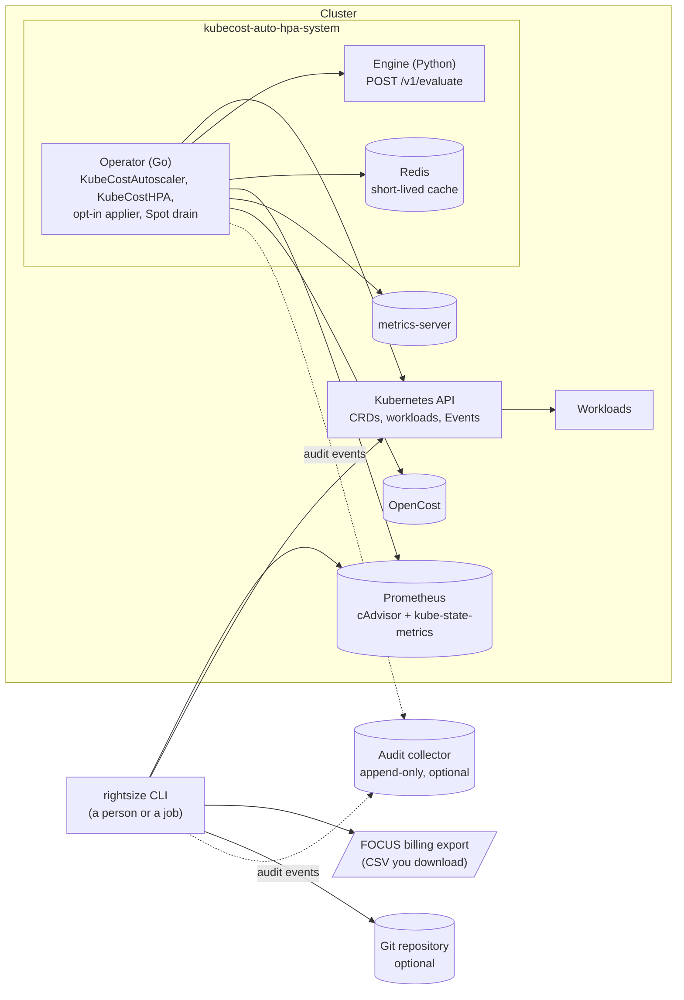
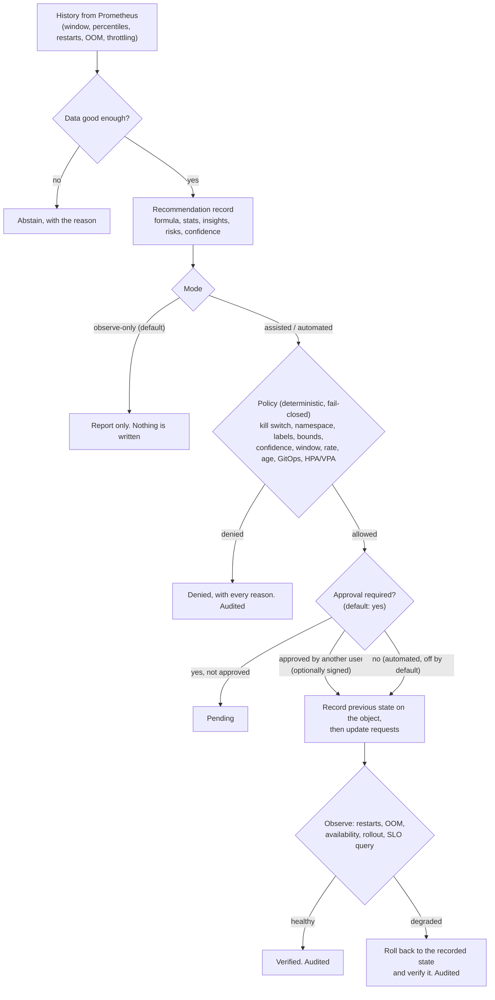
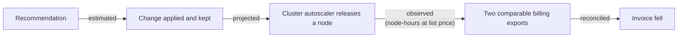

# Architecture

Two independent halves share the repository. Keep them apart in your head: the first scales replicas, the second proposes and (under a policy) applies requests.

## 1. Autoscaler (existing)

`KubeCostAutoscaler` / `KubeCostHPA` controllers in `operator/internal/controller`: demand from `metrics.k8s.io` (and Prometheus for the legacy CRD), cost from KubeCost,
decisions from the pure `internal/policy`, writes through `internal/actuator`, single-writer rules in `internal/ownership`. See README, `docs/KUBECOST_AUTOSCALER.md`, `docs/RBAC.md`.
Global switch: `--observe-only` (chart default `true`) turns every decision into a report.

## 2. Rightsizing pipeline (new, ADR-0001 and ADR-0002)

```
 Prometheus (cAdvisor + kube-state-metrics)
        |  read-only HTTP                         internal/recommend/promsrc
        v
 internal/recommend      pure: percentiles, headroom, vetoes, abstention  --> Recommendation (JSON, self-describing, ID)
        |                                                                  cmd/recommend
        v
 internal/safety         pure, fail-closed: policy + facts --> allowed / reasons
        |  (human approval = annotation holding the exact ID)
        v
 internal/execute        apply (previous state saved on the object, resourceVersion update)
                         -> watch (restarts, OOM, availability, replicas, optional SLO query)
                         -> rollback (restore, read back, verify)     cmd/rightsize
        |
        v
 audit JSONL (decision, dry_run, applied, verified, degraded, rolled_back, *_failed)

 internal/cost      allocation + reconciliation, billing adapter seam (estimated / billed / allocated kept apart)
 internal/capacity  "would a node actually be released?" (candidate analysis, no actions)
```

Since ADR-0003 there is also an **opt-in** cluster path: `WorkloadRecommendation` objects (published with `plan --publish`, approved through their status subresource) applied by a controller inside the operator under a policy ConfigMap. It is off by default.

Design rules (all enforced by tests):

* The recommender has no Kubernetes client and no write path. The policy engine never computes numbers. The executor never decides alone.
* Default is dry-run. `--execute` needs an explicit `--context`, a policy that names the namespace, and a human approval of the exact recommendation ID.
* Unknown facts, missing metrics, a VPA that cannot be ruled out, a stale recommendation or any API error means **no change**.
* The previous state is stored on the Deployment itself; a crashed tool can still roll back. A rolled-back ID is never retried.
* Nothing in `execute` runs unless a person invokes `rightsize` **or** the operator was installed with the applier enabled (ADR-0003); by default there is no controller applying recommendations.

## Not built (and why)

No hosted pull-request integration (GitOps-managed workloads are refused; `rightsize propose` commits on a local branch), no admission webhook to forbid self-approval (separation of duties is by RBAC only), no multi-tenant isolation layer beyond the same-namespace rule, no UI.

## Diagrams (added 2026-11-15)

### Components



Nothing calls a cloud provider API. Billing data enters only as a file.

### Execution flow of one rightsizing change



### Where a saving comes from


