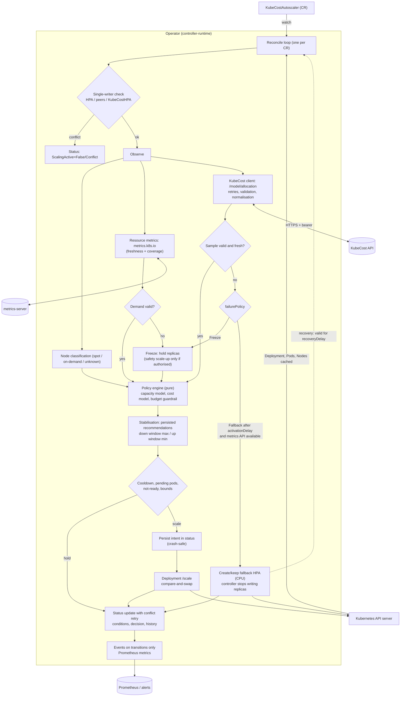

# KubeCostAutoscaler — cost-aware horizontal scaling

`KubeCostAutoscaler` (`autoscaling.kubecost.io/v1alpha1`, namespaced) manages the **replica count** of a
Deployment. Resource demand drives the decision; KubeCost cost data is a *bounded optimisation signal*.
It complements `KubeCostHPA` (in-place vertical resizing); both can target the same Deployment as long as
only one of them has horizontal scaling on (see [Ownership](#2-replica-ownership-single-writer)).

> **Cost is never a substitute for demand.** A lower reported cost cannot remove capacity by itself, and a
> breached budget can never keep an overloaded workload under-scaled.

---

## 1. Repository audit (state before this work)

Evidence comes from the repository at commit `dfd1d59` (all rows verified by reading the code or by a test
that was added with the fix). "Assumption" is marked explicitly.

| Area | Current implementation (evidence) | Gap or risk | Change made | Validation |
|---|---|---|---|---|
| Cost data ingestion | `internal/metrics/kubecost.go`: `MonthlySpend` decodes `data[].<ns>.totalCost` into `float64`; no `code`/`minutes`/window check, no retries, no timestamps | **Verified defect:** a payload with missing/null cost decodes as `0`; stale or partial data is indistinguishable from valid; float money; response key assumed to be the namespace (assumption, not documented) | New `internal/kubecost` client: classified errors, bounded retries with jitter, no-redirect, size limits, nullable-field rejection, workload matched by the documented `properties` fields, hourly normalisation in exact arithmetic. The legacy budget guardrail is left as is (documented limitation) | `internal/kubecost/client_test.go` (table-driven: 401/403/429/5xx/redirect/malformed/null/negative/NaN-string/ambiguous/stale/timeouts/credential leakage) |
| Money arithmetic | `float64` USD everywhere | **Verified risk:** `0.1+0.2 > 0.3` makes strict budget boundaries wrong | `internal/money`: micro-dollar `int64`, `math/big` parsing, saturation, `Ratio` for multipliers | `money_test.go`, `TestStrictBudgetBoundary` |
| Autoscaling control loop | `KubeCostHPA` scales replicas through the Python engine (`SetReplicas` → `UpdateScale`) | Horizontal logic lives in Python; no persisted recommendation history; replica writes had no compare-and-swap | Go decision engine `internal/policy` (pure, deterministic); `actuator.DeploymentScaler` is compare-and-swap (value check + resourceVersion) | `policy_test.go` (incl. a closed-loop oscillation simulation), `TestRealAPIServer_ScalesThroughTheScaleSubresourceAndWritesStatus` |
| Replica ownership / HPA conflict | `grep -ri horizontalpodautoscaler operator/` returned nothing: **no conflict detection at all** | **Verified defect:** `KubeCostHPA.spec.replicas` would fight a native HPA over `spec.replicas` | `internal/ownership`: refuses to write when a native HPA, another autoscaler or a replica-scaling `KubeCostHPA` targets the Deployment; the legacy controller got the same guard (and no longer acts on engine output it did not request) | `TestNeverWritesReplicasWhileAnIndependentHPAIsActive`, `TestRealAPIServer_NativeHPAConflictBlocksAllWrites`, `TestLegacyHorizontalScalingYields*` |
| Downscale protection | One cooldown (`status.lastResizeTime`/Redis); no stabilisation window semantics | A temporary signal could remove capacity once the cooldown elapsed | HPA-style stabilisation windows over **persisted** recommendations + cooldown + freshness as three independent controls; warm-up after history loss | `TestRepeatedLowRecommendationsCannotBypassStabilisationWindow`, `TestRestartKeepsStabilisationState`, `TestHistoryGapRestartsWarmup` |
| Spot awareness | Only the node drain controller (`node_controller.go`) | Workload placement ignored by scaling | `internal/infra` classifier + capacity discount + class price weights | `infra_test.go`, `TestSpotCapacityIsNotGuaranteedCapacity`, `TestMarginalCostModelUsesCapacityClassMultipliers` |
| Failure handling | `KubeCostHPA`: budget fail-open/`FreezeGrowth`; no fallback path | No resource-metrics fallback, no recovery rules | `failurePolicy` (Freeze / ResourceMetricsFallback) with activation/recovery delays, operator-owned HPA, status-backed state machine | Scenario table in §9 |
| Security and operations | RBAC generated from markers; token via env/file; TLS flags | New resource needs least-privilege RBAC, URL validation, no redirects, metric hygiene | Read-only access to the new CR spec, no Secret access, URL validation, bounded labels | §10, `TestCredentialsNeverAppearInErrors`, `TestManagerRunsKubeCostAutoscaler...` (token not in logs) |
| Repository hygiene | `engine/build/lib/...` was tracked (committed by mistake in `5947c60`) | Stale copy of the engine sources in git | Removed, `build/` and `dist/` ignored | `git ls-files engine/build` is empty |

Not audited / unknown: the behaviour of a **live KubeCost installation** (see §5), clusters other than envtest 1.33
and kind 1.33.

---

## 2. Replica ownership (single writer)

**Decision:** a dedicated reconciler is the *sole* writer of `spec.replicas` for the target. Competing writers
are detected and the controller stands down.

Alternatives considered and rejected:

| Alternative | Why not |
|---|---|
| Native HPA fed by an external-metrics adapter (cost as a metric) | Needs an extra component (adapter/APIService/KEDA); a cost metric cannot express "budget never blocks the replicas required for the utilisation ceiling" or persisted stabilisation tied to cost state; cost per replica is not a utilisation signal |
| Patching an existing HPA's `minReplicas`/`maxReplicas` | Mutates objects owned by users/GitOps; races with their tooling |

Rules enforced on **every** reconcile, before any I/O to KubeCost:

1. Another `HorizontalPodAutoscaler` targets the Deployment (and is not our fallback) → **Conflict**, no writes.
2. A `KubeCostHPA` targets it with `spec.replicas` set → **Conflict**.
3. Several `KubeCostAutoscaler`s target it → the oldest (`creationTimestamp`, then name) wins; the others stand down.
4. Our fallback HPA (controller reference to the autoscaler) exists → the autoscaler does **not** write replicas;
   it is re-adopted into `status.fallback` even if the status was lost.

`status.scalingOwner` is `Operator`, `FallbackHPA` or `None`. The legacy `KubeCostHPA` applies the mirror rule: with a
native HPA or a `KubeCostAutoscaler` on the same Deployment its horizontal scaling is switched off
(condition `ReplicaOwnership`), while vertical resizing keeps working.

---

## 3. Architecture



Package map (`operator/internal`):

| Package | Responsibility | I/O |
|---|---|---|
| `money` | exact micro-USD / ratio arithmetic | none |
| `kubecost` | allocation API client, error classes, sample validation | HTTP |
| `resmetrics` | utilisation from `metrics.k8s.io`, API availability | HTTP (k8s) |
| `infra` | node/pod capacity classification, capacity factor | none |
| `policy` | **pure** decision engine and stabilisation history | none |
| `ownership` | single-writer checks, fallback HPA lifecycle | k8s API |
| `actuator` | `/scale` compare-and-swap writes | k8s API |
| `controller` | orchestration, failure state machine, status, metrics, events | — |

---

## 4. Reconciliation lifecycle

1. Read the CR; resolve defaults and validate (`InvalidSpec` → no I/O at all).
2. Read the target Deployment (`TargetNotFound` → drop our fallback HPA, keep watching).
3. Single-writer check (§2). Re-adopt a fallback HPA found in the cluster.
4. `spec.replicas == 0` → paused (same convention as the native HPA).
5. Observe: pods, nodes (cache), utilisation, KubeCost sample (cached 20 s per CR).
6. Update failure bookkeeping in `status.failure` (restart-safe).
7. Fallback state machine (§9) — when the HPA owns scaling, the loop ends here.
8. `policy.Evaluate` → `Decision`.
9. Apply: persist the intent (`lastScaleTime/From/To`) **before** the write, then compare-and-swap through `/scale`;
   on failure the intent is reverted so the cooldown does not start.
10. Conditions, events (only on a reason change), metrics, status write with conflict retry.
11. Requeue after `evaluationInterval`, backed off exponentially (cap 5 min, +≤10 % jitter) while signals fail.

Watches: the CR (generation changes only — status writes never retrigger it), the fallback HPA (`Owns`), and the
target Deployment through a field index (only replica/ready/generation changes).

---

## 5. Cost model and the KubeCost contract

Definitions (they are **not** interchangeable):

| Quantity | Meaning |
|---|---|
| Observed hourly cost | `allocation.totalCost * 60 / allocation.minutes` over `costPolicy.window`: the *allocated run-rate averaged over the window* (USD/h) |
| Per-replica cost | observed hourly cost / ready replicas at sample time |
| Marginal cost of **adding** a replica | per-replica cost × (On-Demand weight / blended weight): added replicas are priced **On-Demand** (Spot is not guaranteed to be available) |
| Marginal cost of **removing** a replica | per-replica cost × (cheapest class present weight / blended weight): savings are not overstated |
| Budget | `maxHourlyCostUSD` (hard bound on discretionary headroom), `targetHourlyCostUSD` (soft: triggers cost pressure) |

Blended weight = `(spot·w_spot + (on-demand + unknown)·w_od) / placed pods`. Weights are *relative price
weights* (`spotMultiplier`, `onDemandMultiplier`), never capacity.

**Estimate validity.** If the replica count changed inside the cost window (`now - lastScaleTime < window`) the
per-replica figure is a blend of two sizes: the sample is marked `stable=false` and treated as **unavailable** for
cost decisions (fail closed). The estimate also assumes homogeneous replicas; it is *an estimate, not a bill*.

**API contract used** — `GET {base}/model/allocation?window=<w>&aggregate=controller&accumulate=true`:

```json
{"code":200,"status":"success","data":[{"<key>":{
  "name":"…","properties":{"cluster":"…","namespace":"…","controller":"…","controllerKind":"deployment"},
  "window":{"start":"…","end":"…"},"start":"RFC3339","end":"RFC3339","minutes":15,"totalCost":0.75}}]}
```

* The field names were **verified against the OpenCost source** (`core/pkg/opencost/allocation_json.go`,
  `allocationprops.go`, `docs/swagger.json`), whose allocation API KubeCost extends. They were **not validated
  against a live KubeCost installation**, and `docs.kubecost.com` was not reachable when this was written.
  Note that the OpenAPI file types `properties` as `map<string,string>` although the source emits arrays/objects
  (`services`, `labels`); the client therefore decodes `properties` leniently and reads only string fields.
* The workload is matched on `properties.namespace`, `properties.controller` (+ `controllerKind` when present,
  + `cluster` when configured). Several matches → `ambiguous` (fail closed). The aggregate *key* format is not relied on.
* Every field used is a nullable pointer upstream; `null`, missing, negative, non-numeric, zero-`minutes` values are
  rejected. Responses are limited to 16 MiB; redirects are never followed (a bearer token cannot leak to another host).
* Pagination: the allocation API returns one accumulated set; more than one set is treated as malformed.
* **Freshness:** the age of a sample is `now − allocation.end`. KubeCost does not expose how far its own ingestion lags
  behind, so a pipeline that silently stops cannot be detected from the response alone. Alert on KubeCost's own health
  as well, and keep `maxMetricAge` ≥ KubeCost's ingestion delay (default 5 m).
* Coverage: the allocation must cover ≥ 50 % of the requested window, otherwise the hourly normalisation is not
  representative (workload too young) → stale.

---

## 6. Scaling algorithm

Notation: `L = util · ready` (load in replica-equivalents), `cf` = capacity factor (§8), targets
`t` (target), `c` (cost-pressure), `u` (ceiling), `need(x) = ceil(L / (x·cf))`.

```
0. cur > max  -> max            cur < min -> min            (immediately, whatever the signals)
1. demand invalid                         -> InvalidMetrics (hold)
2. Rd = need(t)  (= cur if |util/t - 1| <= tolerance)        comfortable replicas
   Rs = need(u)                                              safety replicas
   emergency = Rs > cur
3. cost required and invalid/unstable     -> InvalidMetrics (Freeze); only a safety scale-up to Rs is allowed
4. cand = Rd
   pressure = projected(Rd) > targetHourly  or  projected(Rd) > maxHourly       (cost of the *comfortable* size, not of today's spend)
   if pressure:  Rc = need(c) (= cur inside tolerance);  cand = min(cand, Rc)       ("run hotter", never above u)
   if guardrail: Rb = largest R with projected(R) <= maxHourly
                 cand = min(cand, max(Rb, Rs))                                       budget caps comfort, never safety
   cand = max(cand, Rs)                                       safety is a floor for everything
   cand = clamp(cand, max(min, minHealthy), max)
5. record cand in the persisted history
6. cand > cur:  pending pods -> hold
                emergency & allowSafetyScaleUp -> proposed = cand (no window, no cooldown)
                else proposed = max(cur, min of recommendations in scaleUpWindow); cooldown applies
   cand < cur:  pending pods / not all ready / terminating pods -> hold
                history must cover downscaleWindow (else ScaleDownWarmup)
                proposed = min(cur, max of recommendations in downscaleWindow); cooldown applies
```

Properties (each one is a test in `policy_test.go`):

* **Budget never causes under-scaling:** `Rs` is a floor; an overloaded workload scales to its safety size even at
  2.4× the budget.
* **Cost pressure is controlled optimisation:** the target moves from `t` to `c ≤ u`, so utilisation never exceeds
  the ceiling because of cost. When cost rises but demand is constant the replica count converges (simulation:
  `TestNoOscillationUnderConstantDemand`: 9 → 7 and stays; a price doubling afterwards changes nothing).
* **No cost feedback loop:** pressure is judged on what the comfortable size `Rd` would cost, a function of demand
  only. Judging it on today's spend (an earlier version did) made the controller its own disturbance: running hotter
  lowered the spend below the target, the pressure vanished, demand scaled it back up, the spend rose again. The
  simulator found this (`internal/sim`, `TestConstantDemandNeverReversesDirection`: 5 reversals in 2 h at constant
  demand) and `TestCostPressureIsJudgedOnTheComfortableSizeNotOnCurrentSpend` pins the fix.
* **No oscillation:** hysteresis (`tolerance`), stabilisation windows, cooldown, and the capacity factor depends only
  on the current placement.
* **Cost spikes/dips cannot move replicas on their own:** they change *which* recommendation is recorded; removal
  still requires the whole `downscaleWindow` of consistent recommendations.

---

## 7. Stabilisation, cooldown and freshness (three independent controls)

| Control | Field | Purpose | Applies to |
|---|---|---|---|
| Stabilisation window | `stabilization.downscaleWindow` (10 m), `scaleUpWindow` (30 s) | shapes the *recommendation*: scale-down goes only as low as the **highest** recommendation seen in the window; scale-up only as high as the **lowest** | non-safety changes |
| Cooldown | `stabilization.minimumScaleActionInterval` (60 s) | spaces *actions* | all except safety scale-up |
| Metric freshness | `failurePolicy.maxMetricAge` (5 m) | validates *inputs* | KubeCost samples and `PodMetrics` |

Restart safety: the history (`status.recommendations`, bounded by retention and `maxItems: 512`) and
`status.lastScaleTime` live in the status subresource. A new controller process continues the same window
(`TestRestartKeepsStabilisationState`, `TestScaleDownOnlyAfterStabilisationWindowAndSurvivesRestart`).
If the history is lost or the controller was silent longer than `max(3 min, 6×interval)`, stabilisation
**warms up again** before any scale-down (`ScaleDownWarmup`) instead of trusting an empty window.
The scale intent is persisted *before* the write, so a crash in between delays the next action (cooldown) rather
than repeating it.

---

## 8. Spot / Preemptible awareness

* Nodes are classified from labels by `internal/infra`. Built-in rules (override with `spotNodeLabels` /
  `onDemandNodeLabels`; verify against *your* nodes):

  | Provider/tool | Spot | On-Demand |
  |---|---|---|
  | EKS managed node groups | `eks.amazonaws.com/capacityType=SPOT` | `…=ON_DEMAND` |
  | Karpenter | `karpenter.sh/capacity-type=spot` | `…=on-demand` |
  | GKE | `cloud.google.com/gke-spot=true`, `…gke-preemptible=true`, `…gke-provisioning=spot\|preemptible` | `…gke-provisioning=standard` |
  | AKS | `kubernetes.azure.com/scalesetpriority=spot` | `…=regular` |

* A node matching both a Spot and an On-Demand rule, no rule, or a node missing from the cache is **Unknown**:
  priced as On-Demand and **not** discounted (conservative for both cost and capacity).
* **Spot is not guaranteed capacity:** a Spot replica counts as `1 − spotInterruptionBufferPercent` of a replica in
  `need()`. An all-Spot workload therefore needs more replicas for the same load (`TestSpotCapacityIsNot…`).
* Class price weights are used only to split the observed blended cost (§5); they never raise or lower capacity.
* Feedback loop: the factor is computed from the **current** pods only and is bounded (buffer ≤ 90 %); a change of
  placement shifts `need()` by a bounded amount that is then subject to tolerance, windows and cooldown.
* Mixed workloads are handled deterministically (counts per class; the same inputs give the same decision).
* `status.infrastructure` and `kubecost_autoscaler_node_classification` expose the classification.

---

## 9. Failure policies and recovery

`failurePolicy.mode`:

* **Freeze** (default): signals invalid → replicas are held; no scale-down of any kind; a *safety scale-up*
  (utilisation above the ceiling) is allowed only if `allowSafetyScaleUp: true`.
* **ResourceMetricsFallback:** like Freeze, and if **cost** data stays invalid for `fallbackActivationDelay` *and* the
  resource metrics API is verified available (discovery of `metrics.k8s.io/v1beta1` serving `pods`), the controller
  creates a native `autoscaling/v2` HPA (`kca-<name>`, CPU utilisation `fallbackTargetCPUUtilizationPercent`,
  same min/max, **controller reference** to the autoscaler) and **stops writing replicas**. After
  `recoveryDelay` of continuously valid signals it deletes the HPA and resumes. Switching the mode back to `Freeze`
  releases it immediately. An object with the fallback name that we do not control is never modified.

| # | Scenario | Behaviour | Proof |
|---|---|---|---|
| 1 | KubeCost down 30 s | replicas held, `Degraded=True/Frozen`, backoff on requeue; on recovery counters reset | `TestKubeCostOutageFreezesThenRecovers` |
| 2 | HTTP 500 / 429 / network | `transient`: bounded retries (3, exp. backoff + jitter) then Freeze; 401/403 `auth` are not retried | `kubecost` `TestRetries…`, `TestFailureClassesAllFreeze/http 500, auth` |
| 3 | HTTP 200, malformed JSON | `malformed` → Freeze | `TestClassification`, `TestFailureClassesAllFreeze` |
| 4 | Valid but stale / partial window | `stale` → Freeze | `TestFailureClassesAllFreeze/stale, partial` |
| 5 | Kubernetes API unavailable | no decision, error returned (controller-runtime backoff), nothing written; recovers | `TestKubernetesAPIOutageDoesNothingAndRecovers` |
| 6 | Fallback requested, metrics API missing | HPA **not** created, stays Frozen, `Degraded/FallbackUnavailable` | `TestFallbackRequiresWorkingResourceMetrics` |
| 7 | Restart during cooldown/window | state read from status; no double action, window continues | `TestRestartDuringCooldownDoesNotRescale` |
| 8 | Target deleted | `Ready=False/TargetNotFound`, fallback HPA removed, keeps watching; resumes if it returns | `TestTargetDeletedIsHandled` |
| 9 | Over budget under heavy demand | scales to the **safety** size, never to comfort | `TestSafetyScaleUpIsAppliedEvenOverBudget` |

### Emergency stop

`kubectl annotate kubecostautoscaler <name> autoscaling.kubecost.io/pause=true` stops every write of that
autoscaler at once, without a restart: decisions are still computed and explained
(`status.lastDecision`, message prefix `paused:`, `ScalingActive=False/Paused`) but no replica is changed and no fallback
HPA is created or removed. The workload keeps its current size and a running fallback HPA or any native HPA keeps
acting, so the application stays autoscaled. Remove the annotation (`...pause-`) to resume on the next reconcile.
Cluster-wide: `kubectl annotate kubecostautoscalers --all -A autoscaling.kubecost.io/pause=true --overwrite`.
Pausing never relaxes a safety rule: it only removes the operator's ability to act. (Tests:
`TestPauseAnnotationStopsAllWritesAndResumesWhenRemoved`, `TestPauseDoesNotTouchAnActiveFallbackHPA`.) Disabling the
controller entirely is `operator.enableCostAutoscaler=false` (restart).

Error classes are coarse and the only error detail stored in status (`status.failure.lastErrorClass`); raw
bodies and headers are never stored or logged.

---

## 10. Security and trust boundaries

| Boundary | Trust | Controls |
|---|---|---|
| Operator ↔ Kubernetes API | authoritative for objects | generated least-privilege ClusterRole (below); leader election |
| Operator → KubeCost | **untrusted data**, trusted endpoint | https/http URL validated (no userinfo/query/fragment), TLS verification on (`--kubecost-ca-file`, mTLS flags), bearer token from env/file (re-read per request), no redirects, size limit, strict schema validation, token never in errors/logs |
| Operator → metrics-server | partially trusted | sample age and ≥50 % pod coverage required |
| Workload namespaces | tenants | `targetRef` has **no namespace**: an autoscaler only touches Deployments in its own namespace; `targetRef` is immutable |
| Fallback HPA | owned by the operator | controller reference; never touches foreign objects |

RBAC (see `config/rbac/role.yaml`, generated from `+kubebuilder:rbac` markers): `kubecostautoscalers` **read-only** plus
`/status`; `deployments` read; `deployments/scale` get/update; pods, nodes read; `metrics.k8s.io` pods read;
`horizontalpodautoscalers` CRUD (only used for the fallback — drop this rule and use `mode: Freeze` if you do not
want the operator to create HPAs); events. **No Secret access** (the token is injected as env/file), no cluster-admin.
Egress needed by the operator: DNS, the API server, Prometheus (legacy controller), KubeCost, the engine, Redis; the
Helm chart accepts a raw egress rule list (`networkPolicy.operatorEgress`).
The container runs non-root with a read-only root filesystem; resources are requested/limited.

---

## 11. Observability

Metrics (labels are bounded: `namespace`, `name` of the CR plus closed enums):

| Metric | Type | Notes |
|---|---|---|
| `kubecost_autoscaler_current_replicas` / `_desired_replicas` | gauge | |
| `kubecost_autoscaler_hourly_cost_usd` / `_budget_usd` | gauge | allocated run-rate; configured maximum |
| `kubecost_autoscaler_metric_age_seconds` | gauge | age of the last valid sample |
| `kubecost_autoscaler_scaling_decisions_total{type}` | counter | ScaleUp/ScaleDown/Hold/Fallback/InvalidMetrics |
| `kubecost_autoscaler_scaling_action_total{direction,result}` | counter | |
| `kubecost_autoscaler_kubecost_api_errors_total{class}` | counter | no per-workload label |
| `kubecost_autoscaler_fallback_active` | gauge | |
| `kubecost_autoscaler_node_classification{class}` | gauge | spot/ondemand/unknown/pending |

Series are deleted when a CR is deleted. Alerts (Helm `prometheusRule.enabled`): stale cost data, persistent API errors,
auth failure, fallback active, repeated scale failures, over-budget. Conditions: `Ready`, `MetricsAvailable`, `Degraded`,
`ScalingActive`, with reasons such as `Conflict`, `InvalidSpec`, `TargetNotFound`, `CostTransient`, `Frozen`,
`FallbackActive`, `ScaleFailed`, `ReplicaDrift`. Events are emitted **only when a condition's reason changes**.

Troubleshooting: `kubectl get kca -o wide`; `kubectl describe kca <name>` (conditions + events);
`status.lastDecision.reason` explains holds (`ScaleDownWarmup`, `Cooldown`, `PendingPods`, `WithinTolerance`, …).

---

## 12. Installation

```bash
# CRDs + operator (Kustomize)           # or Helm
kubectl apply -k operator/config/default   helm install kch deploy/helm/kubecost-auto-hpa -n kubecost-auto-hpa-system --create-namespace \
                                             --set kubecost.url=http://kubecost-cost-analyzer.kubecost:9090 \
                                             --set auth.kubecost.secretName=kubecost-auto-hpa-kubecost

kubectl apply -f operator/config/samples/autoscaling_v1alpha1_kubecostautoscaler.yaml   # dryRun: true
```

Requirements: Kubernetes ≥ 1.29 (CEL `quantity`/transition rules) — validated on 1.33; metrics-server for demand
(and for the fallback); the operator started with `--kubecost-url` (otherwise this controller is not registered).

---

## 13. Testing

```bash
cd operator
make check        # gofmt, vet, unit, -race, integration (real Python engine)
make envtest      # real kube-apiserver 1.33 + etcd (KUBEBUILDER_ASSETS)
make manifests && git diff --exit-code    # generated code/CRDs/RBAC are current
go run ./cmd/simbench                     # deterministic synthetic HPA vs KubeCostAutoscaler comparison (docs/BENCHMARKS.md)
```

---

## 14. Known limitations and rollout guidance

* The KubeCost response schema is verified against OpenCost, **not against a live KubeCost** (§5); the per-replica cost
  is an estimate (homogeneous replicas, window average) and is withheld while replicas changed inside the window.
* Freshness cannot detect an ingestion stall inside KubeCost that still reports a recent `end`.
* Demand metrics come from `metrics.k8s.io` (CPU/memory); custom/external demand metrics are not supported. The fallback
  HPA is CPU-only. Only `Deployment` targets.
* The controller is exercised end to end against a real API server (envtest) and on a kind cluster with a real
  metrics-server (`e2e-kca`, KubeCost stubbed), but **not** against a live KubeCost installation.
* The cost signal is "unstable" for a full cost window after **any** change of the replica count: one this controller made (`status.lastScaleTime`) or one
  made by anyone else (`status.lastReplicaChangeTime`, recorded when the observed count differs from the last one this controller saw or wrote).
* While replicas changed inside the 15-minute cost window the cost signal is "unstable" and the engine falls back to
  its Freeze semantics for non-safety moves (§9). The simulator quantifies the price of that conservatism: slower
  scale-down in a decline and time spent at the utilisation ceiling during a ramp (docs/BENCHMARKS.md).
* The fallback HPA needs cluster-wide HPA write permission; use `Freeze` if that is unacceptable.
* Rollout: start with `dryRun: true`, watch `status.lastDecision` for a full business cycle, set generous `maxReplicas`,
  then enable on a non-critical service; alert on `FallbackActive` and `StaleCostData` from day one.
