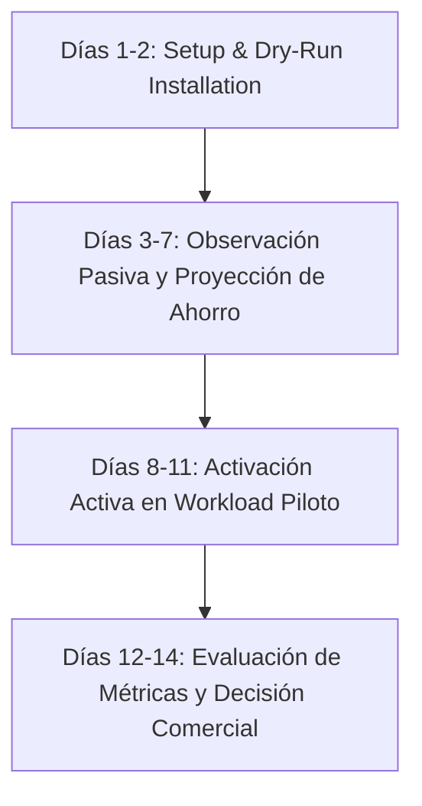

# Enterprise Proof of Concept (POC) Playbook

A structured, 14-day evaluation program designed to prove financial savings and operational safety in your own Kubernetes clusters with **zero production risk**.

---

## 1. POC Objectives & Success Criteria

Before commencing the POC, the customer platform team and the vendor agree on explicit success criteria:

1. **Safety & Zero Disruption:** 0 unplanned container restarts and 0 SLA/SLO violations caused by the autoscaler.
2. **Measurable Efficiency Gain:** Demonstrated compute request reduction of **≥ 20%** or verified Spot cost savings of **≥ 30%** on target workloads.
3. **Graceful Fallback:** Verification that simulated Prometheus or KubeCost disconnects safely freeze scaling or engage native fallback without service degradation.

---

## 2. The 14-Day POC Timeline



### Phase 1: Preparation & Non-Invasive Dry-Run (Days 1–2)
- **Action:** Deploy the Helm chart with `spec.dryRun: true` on target `KubeCostAutoscaler` resources.
- **Risk Level:** **Zero.** In `dryRun` mode, the operator calculates scaling decisions, logs unit economics, and emits metrics, but **never executes any write operations** to the Kubernetes API.
- **Deliverables:**
  - Operator running in non-root security context.
  - Verification of Prometheus and KubeCost allocation API connectivity.

### Phase 2: Passive Baseline & Projected Savings (Days 3–7)
- **Action:** Allow the autoscaler to observe natural workload traffic cycles (peak hours, overnight dips, weekend patterns).
- **Review:**
  - Inspect `.status.lastDecision` across business hours.
  - Review Grafana dashboards tracking `kubecost_autoscaler_projected_savings_monthly` and `$/request`.
- **Checkpoint Meeting (Day 7):** Compare projected savings against actual AWS/GCP bill to validate the mathematical model.

### Phase 3: Controlled Live Resizing on Pilot Target (Days 8–11)
- **Action:** Switch `spec.dryRun: false` on **1 selected non-critical service** (e.g., staging API, asynchronous worker, or internal tool).
- **Verification:**
  - Observe in-place resizing via `kubectl get pods -w` (watch cgroups update without container restarts).
  - Inject simulated traffic bursts to confirm prompt, safe scale-out.
  - Review p99 latency before and after scaling actions to verify SLA adherence.

### Phase 4: Production Evaluation & Business Decision (Days 12–14)
- **Action:** Compile the **POC Executive Value Report**:
  - Total compute hours saved.
  - Realized cost savings in USD.
  - Latency impact (delta in p99).
- **Executive Review:** Present findings to the VP of Engineering and Head of FinOps.
- **Outcome:** Conversion to annual Enterprise Subscription or managed support contract.

---

## 3. Rollback & De-risking Guarantees

The autoscaler is designed from first principles with multiple layers of safety:
- **Instant Global Pause:**
  ```bash
  kubectl annotate kubecostautoscalers --all -A autoscaling.kubecost.io/pause=true --overwrite
  ```
  Freezes all scaling actions cluster-wide instantly while preserving observability.
- **Clean Uninstallation:**
  Deleting a `KubeCostAutoscaler` triggers a built-in Kubernetes Finalizer that restores the Deployment's original CPU and Memory requests/limits before detachment.
